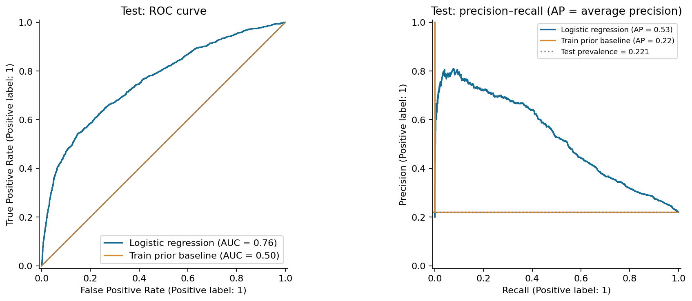
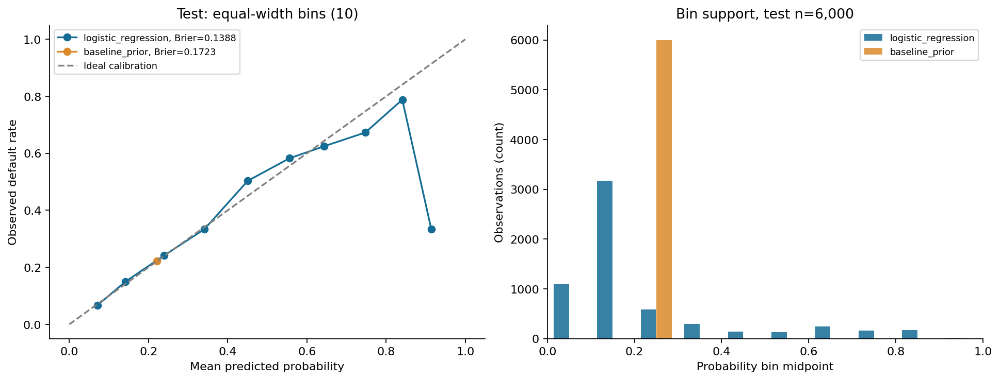

# Прогнозирование просрочки по кредитным картам

Учебный портфолио-проект на Python: прогноз метки дефолта в следующем месяце и анализ факторов риска действующих клиентов. Полный цикл — от официального файла UCI до оценки на отложенной выборке, графиков и воспроизводимого отчёта.

**Практический вопрос:** кого из действующих клиентов направить на дополнительную проверку, если её условная вместимость — до 30% validation? Это учебная политика, а её полезность для реального банка здесь не проверяется.

[Подробный отчёт](report/report.md) · [Метрики](exports/metrics_test.csv) · [Независимая проверка](report/review.md) · [Техническое задание](PROJECT_BRIEF.md)

## Результаты

На test: **6,000 клиентов**, 1,327 с меткой 1 и 4,673 с меткой 0. Правило классификации: вероятность **≥ 0.2**. Порог выбран на validation до оценки test.

| Метрика на test | Baseline: train prior | Логистическая регрессия |
|---|---:|---:|
| ROC-AUC | 0.5000 | 0.7594 |
| Average precision (AP) | 0.2212 | 0.5255 |
| Brier score, меньше лучше | 0.1723 | 0.1388 |
| Порог | 0.5 | 0.2 |
| Precision | 0.00%* | 45.08% |
| Recall | 0.00% | 58.70% |
| F1 | 0.0000 | 0.5100 |
| Доля направленных на проверку | 0.00% | 28.80% |

*Константный baseline выдаёт частоту класса на train (0.2212); при пороге 0,5 он никого не направляет на проверку. Precision без положительных прогнозов не определён; в выгрузке используется `zero_division=0`. Пороговые метрики сравнивают разные правила действий, поэтому улучшение ранжирования оценивается по ROC-AUC и AP. AP здесь — average precision sklearn, не трапециевидная площадь под PR-кривой. Accuracy не используется как основной критерий.



При выбранном пороге на проверку попадают **1,728 / 6,000 (28.80%)** клиентов: **TP=779, FP=949, TN=3724, FN=548**. Модель обнаруживает 58.70% наблюдаемых дефолтов, пропускает 548 и ошибочно направляет на проверку 949 клиентов без дефолта. FPR = FP/(FP+TN) = 20.31%; precision = TP/(TP+FP), recall = TP/(TP+FN).

Это направления на дополнительную проверку, а не наблюдаемые отказы в выдаче кредита. Затраты, денежные потери и эффект вмешательства не оценивались. `LIMIT_BAL` и метка дефолта не равны сумме убытков.

## Данные и источник

[UCI Default of Credit Card Clients](https://archive.ics.uci.edu/dataset/350/defaultofcreditcardclients), I‑Cheng Yeh (2009), [DOI: 10.24432/C55S3H](https://doi.org/10.24432/C55S3H). Лицензия набора — [CC BY 4.0](https://creativecommons.org/licenses/by/4.0/). Источник и атрибуция сохранены в [metadata](exports/dataset_metadata.json).

- 30 000 клиентов Тайваня; 23 признака, `ID` и бинарная цель. Всего метка 1 у 6,636 клиентов (22.12%); эта общая сводка описательная.
- История платежей за апрель–сентябрь 2005 года. Цель исходного XLS — `default payment next month`, в коде — `default`: 1 — дефолт по платежу в следующем месяце, 0 — его отсутствие по определению набора.
- Это действующие клиенты, не заявки на новые кредиты. Признаки относятся к истории до прогнозируемого месяца; индивидуальные даты событий и полноценная временная проверка отсутствуют.
- XLS имеет дополнительную первую строку: используется `pandas.read_excel(..., header=1, engine="xlrd")`. Схема и SHA-256 проверяются до анализа.
- [Аудит качества и EDA](report/eda_notes.md): пропуски, дубликаты, необычные категории, отрицательные значения и размеры групп. Ничего автоматически не удаляется; смысл недокументированных кодов не выдумывается.
- Сырые данные и строки прогнозов исключены из Git. [Как получить данные и что сохраняется локально](data/README.md).

## Методика

1. Зафиксировано стратифицированное разбиение с `random_state=42`: train 18 000, validation 6 000, test 6 000. Принадлежность строк хранится в `data/generated/splits.csv`; пересечений нет.
2. Зависимости признаков с целью исследуются на train. Общий аудит состава набора помечен как описательный и не используется для выбора модели.
3. `DummyClassifier(strategy="prior")` сравнивается с фиксированной логистической регрессией (`C=1`, `lbfgs`, без весов классов). Подбор гиперпараметров и дополнительная калибровка не проводились.
4. `Pipeline` / `ColumnTransformer` обучаются только на train: медианная импутация и `StandardScaler` для числовых признаков; импутация модой и one-hot для `SEX`, `EDUCATION`, `MARRIAGE` и всех шести статусов `PAY_*`. Категориальное кодирование статусов не предполагает равные расстояния между кодами. Неизвестные значения безопасно обрабатываются как нулевая комбинация, совпадающая с опорной категорией; это ограничение интерпретации.
5. На validation сравниваются заранее заданные пороги 0,2 / 0,3 / 0,5. Выбирается максимальный recall при доле проверки ≤30%; ничья — precision, затем больший порог. Если допустимых порогов нет, выбирается минимальная доля проверки. Выбран **0.2**. [Таблица validation](exports/thresholds_validation.csv), [зафиксированная политика](exports/policy.json).
6. После фиксации политики test используется для итоговых метрик, кривых, reliability diagram и анализа ошибок. [Все заранее заданные пороги на test](exports/thresholds_test.csv) показаны для сравнения без выбора нового порога. Повторные запуски проверяют воспроизводимость, решения по test не пересматриваются.



Калибровка оценена по 10 равным интервалам вероятности с количеством наблюдений в каждом. Brier score улучшился относительно константного baseline, но сам по себе не доказывает идеальную калибровку. Крайний интервал [0,9; 1] содержит всего 3 наблюдения. Проверка на историческом test не гарантирует качество на новых периодах или клиентах.

## Интерпретация и ограничения

- [Коэффициенты и odds ratios](exports/coefficients.csv) — условные ассоциации модели, не причинные эффекты и не вероятности. Для числовых признаков изменение соответствует одному стандартному отклонению train; для категорий — сравнению с опорным кодом. Единицы и [опорные категории](exports/model_spec.json) сохранены.
- Соседние месячные счета, платежи и статусы коррелируют: знаки и величины отдельных коэффициентов могут быть нестабильны. Редкие категории и группы требуют осторожности.
- [Ошибки по полу, возрасту и семейному положению](exports/group_errors_test.csv) приведены с размерами групп и числом дефолтов. Включение чувствительных признаков и различия ошибок не доказывают справедливость или юридическую допустимость модели. Это исторический учебный проект; использовать его для реальных кредитных решений нельзя.
- Проверка случайная, не на будущих периодах; переносимость на современный рынок не установлена. Модель прогнозирует метку UCI, не все виды дефолта и не фактические кредитные убытки.

## Стек и структура

Python 3.12, pandas, NumPy, SciPy, scikit-learn, Matplotlib, xlrd. Прямые зависимости в `requirements.txt`, точное проверенное окружение в `requirements-lock.txt`; фактические версии — [environment.json](exports/environment.json).

```text
├── PROJECT_BRIEF.md       # исходное ТЗ
├── README.md              # этот обзор, формируется из результатов
├── requirements*.txt      # прямые и полные фиксированные зависимости
├── data/README.md         # источник и назначение локальных файлов
├── src/                   # загрузка, EDA, модель, графики, документы
├── tests/                 # методология и согласованность артефактов
├── images/                # PNG, созданные кодом
├── exports/               # агрегированные CSV/JSON, версии и manifest
└── report/                # отчёт, EDA и независимая проверка
```

## Воспроизведение

Поддерживаемая и проверенная версия — **Python 3.12**. Из корня репозитория в Windows PowerShell:

```powershell
py -3.12 -m venv .venv
.\.venv\Scripts\python.exe -m pip install -r requirements-lock.txt
.\.venv\Scripts\python.exe -m src.run
.\.venv\Scripts\python.exe -m unittest discover -s tests -v
```

Linux/macOS с Python 3.12:

```bash
python3.12 -m venv .venv
.venv/bin/python -m pip install -r requirements-lock.txt
.venv/bin/python -m src.run
.venv/bin/python -m unittest discover -s tests -v
```

При первом запуске требуется интернет для установки пакетов и загрузки официального ZIP UCI. Команда `python -m src.run --download-only` отдельно загружает и проверяет XLS. Если сеть недоступна, поместите официальный файл по пути из [инструкции](data/README.md); сообщения об ошибках содержат URL. Следующие запуски используют локальный файл после проверки контрольной суммы.

Полный запуск создаёт таблицы `exports/*.csv`, `exports/*.json`, рисунки `images/*.png`, отчёт `report/report.md`, EDA-заметки и README. Локально сохраняет split membership и вероятности без исходного ID в `data/generated/`. Поддерживается `python -m src.run --output-root .verification/reproduction` для отдельного выходного каталога и проверки повторного запуска; затем `python -m src.verify .verification/reproduction` сверяет таблицы, документы и пиксели PNG. Исходный код остаётся общим. SHA-256 артефактов записываются в `exports/manifest.json`; версии окружения могут различаться между платформами, поэтому числовое сравнение выполняется с допуском, а строгая проверка пикселей рассчитана на одинаковое окружение.

Проверки охватывают разбиения, исключение ID/цели, обучение scaler только на train, неизвестные категории, границы калибровочных интервалов, формулы метрик, выбор порога и суммы ошибок по группам. Результаты независимой проверки и повторного запуска фиксируются в [review.md](report/review.md).
