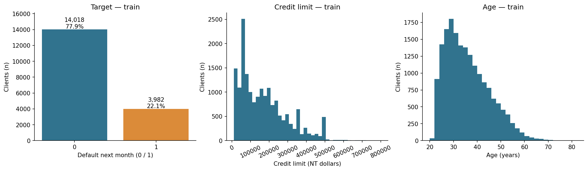
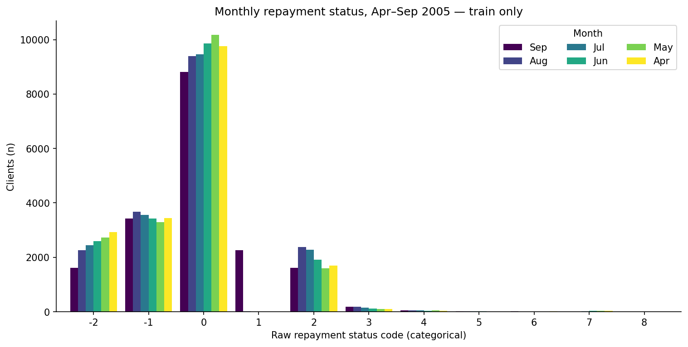
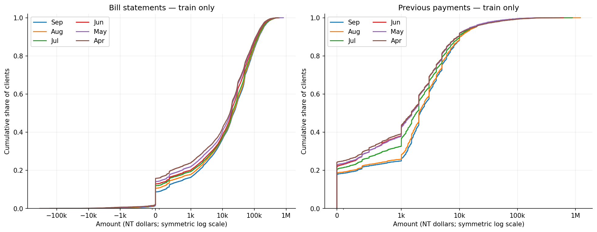
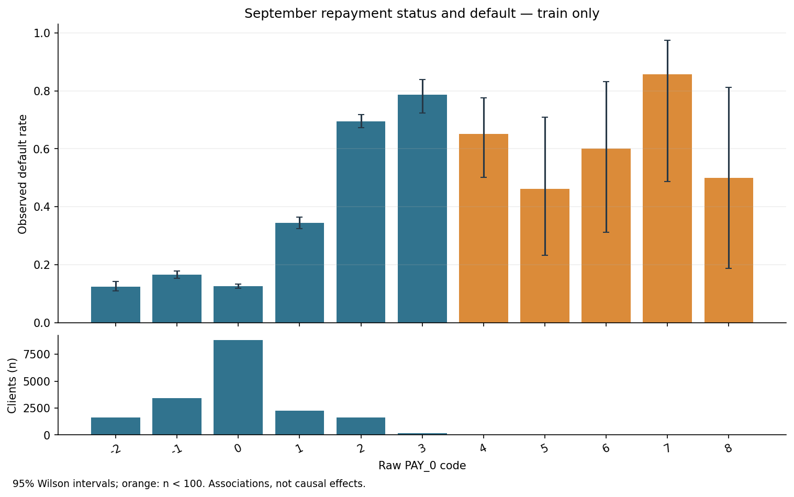
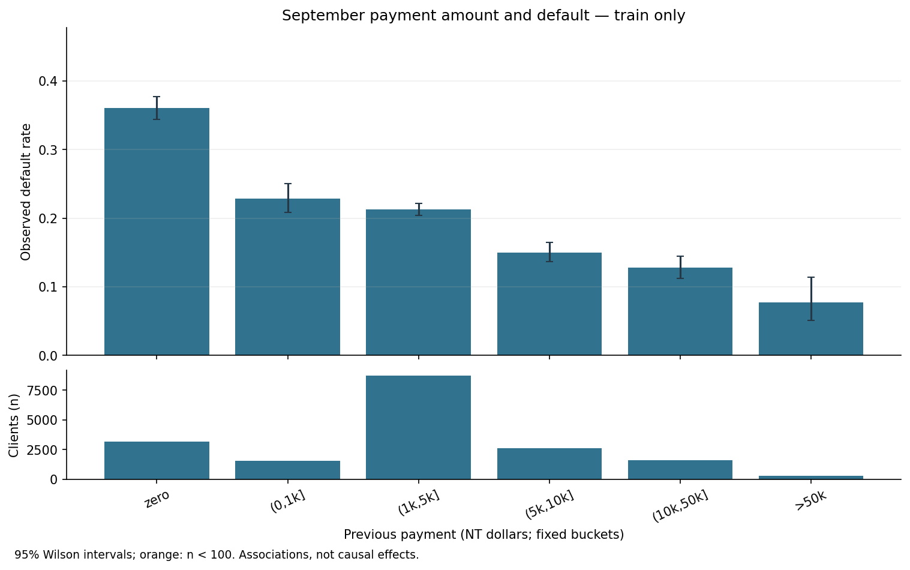
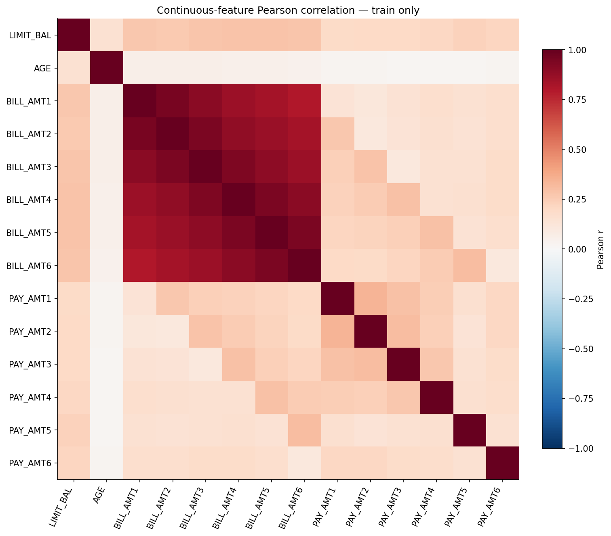

# Наблюдения EDA

Схема, качество и состав классов проверены на всём наборе **только описательно**. Все графики, связи с целевой переменной и корреляции рассчитаны только на train (18,000 записей), после фиксации разбиения. Эти результаты не используются для настройки по test.

## Проверка данных

- Строк до / после: 30,000 / 30,000; ничего не удалено, категории не объединены.
- Признаков без ID и цели: 23; пропущенных ячеек: 0.
- Повторов ID: 0; полных дублей: 0; повторных векторов признаков без ID и цели: 56. Число повторов считается после первого вхождения, это не число групп. Одинаковые признаки не доказывают, что записи принадлежат одному клиенту; они сохранены. Случайное разбиение по строкам не исключает совпадения векторов между выборками.
- Доля метки 1 по всему набору (описательно): 22.12%; на train: 22.12%.
- Наблюдаемые коды, не объяснённые таблицей значений на странице UCI: EDUCATION: 0, 5, 6; MARRIAGE: 0; PAY_0: -2, 0; PAY_2: -2, 0; PAY_3: -2, 0; PAY_4: -2, 0; PAY_5: -2, 0; PAY_6: -2, 0. В частности, статусы −2 и 0 нельзя автоматически называть «без просрочки» или «не использовал карту» либо удалять. Модель кодирует статусы как категории.
- Отрицательных ячеек счетов за шесть месяцев: 3932; отрицательных ячеек платежей: 0. Это число ячеек, а не уникальных клиентов. Знак сохранён без неподтверждённой экономической трактовки. Детали по столбцам — в `exports/eda_amount_signs.csv`.

## Связи на train

В `eda_train_category_associations.csv` и `eda_train_payment_associations.csv` для каждой группы приведены n, число дефолтов, частота, 95% интервал Уилсона и индикатор редкой группы (n < 100). Интервалы описывают неопределённость при предположении независимых наблюдений; это не доказательство причинности и не поправка на множественные сравнения.

Недавний статус PAY_0 и размер PAY_AMT1 показаны отдельно. Платежи разбиты на фиксированные диапазоны в NT dollars; нулевые выделены в свою группу. Сравнения описывают ассоциации и зависят от состава клиентов.

При PAY_0=0 доля дефолтов на train составляет 12.64% (n=8,807), при PAY_0=2 — 69.53% (n=1,618). Для нулевого PAY_AMT1 — 36.08% (n=3,157). Смысл кода 0 не доопределяется; это сравнение наблюдаемых групп. Для PAY_0=4..8 размеры групп менее 100, поэтому хвосты нельзя считать устойчивой монотонной зависимостью.

Корреляция Пирсона соседних месячных счетов на train: 0.933–0.951. Детали и ранговые корреляции — в `eda_train_adjacent_correlations.csv`. Коррелирующие признаки затрудняют отдельную интерпретацию коэффициентов: их знаки и величины могут быть нестабильны. Для необъяснённых кодов статусов числовое расстояние не интерпретируется.

Данные относятся к действующим клиентам Тайваня и истории апреля–сентября 2005 года. Проверки на будущих периодах и новых заявителях нет. Источник: [UCI, I-Cheng Yeh, CC BY 4.0](https://archive.ics.uci.edu/dataset/350/defaultofcreditcardclients).
