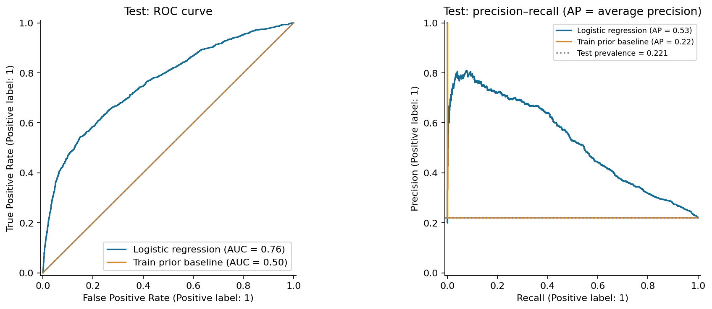
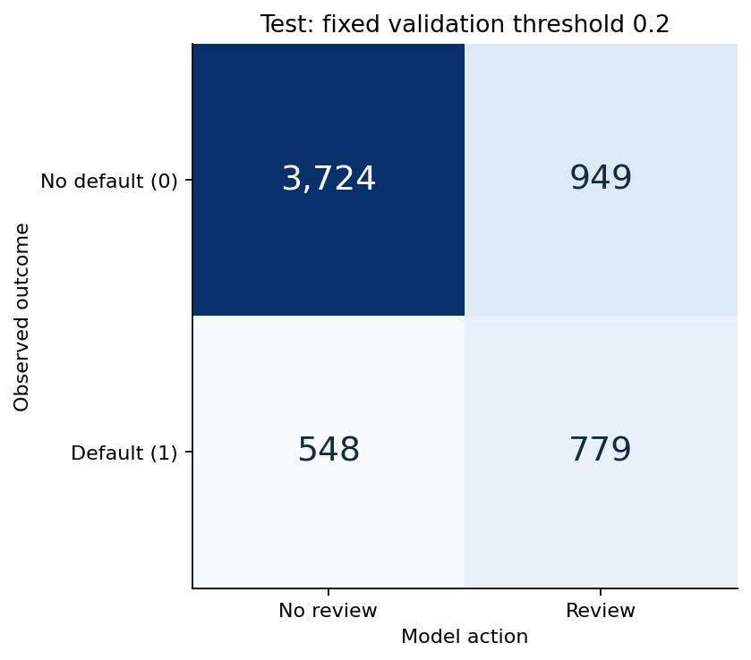
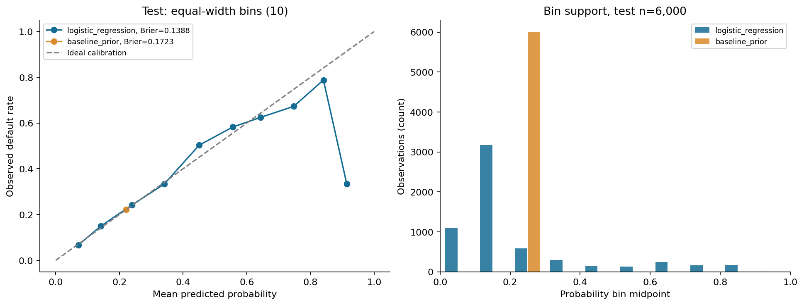
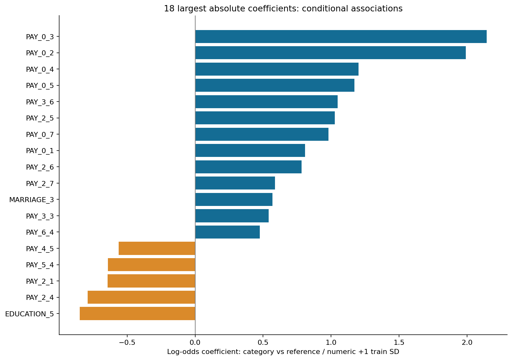

# Прогнозирование просрочки по кредитным картам

Отчёт сформирован из рассчитанных таблиц `exports/`. Числа относятся к одному
зафиксированному историческому разбиению и учебной модели.

## Источник и задача

[UCI Default of Credit Card Clients](https://archive.ics.uci.edu/dataset/350/defaultofcreditcardclients),
I-Cheng Yeh (2009), [DOI 10.24432/C55S3H](https://doi.org/10.24432/C55S3H),
[CC BY 4.0](https://creativecommons.org/licenses/by/4.0/).
В наборе 30 000 действующих клиентов Тайваня, 23 признака и идентификатор ID.
История охватывает апрель–сентябрь 2005 года. Цель `default payment next month`
переименована в `default`: 1 — дефолт по платежу в следующем месяце, 0 — его отсутствие
по определению набора. Это не заявки на выдачу кредита и не фактические кредитные убытки.
Суммы заданы в NT$, возраст — в годах. SHA-256 исходного файла:
`30c6be3abd8dcfd3e6096c828bad8c2f011238620f5369220bd60cfc82700933`. См. [метаданные](../exports/dataset_metadata.json)
и [получение данных](../data/README.md).

## Качество данных и EDA

[EDA-заметки](eda_notes.md) и таблицы `exports/eda_*` содержат проверки схемы,
типов, пропусков, ID, полных дубликатов, необычных кодов и числа строк до/после обработки.
Общая сводка набора — описательная; связи признаков с целью изучены только на train
после фиксации разбиения. Необычные категории и отрицательные суммы не удаляются
автоматически. Статусам −2 и 0 не приписывается не подтверждённый UCI смысл.

## Методика

Стратифицированный test выделен первым: 20% набора. Из остатка 25% отведены
под validation. Оба вызова `train_test_split` используют `random_state=42`.

| Выборка | Клиенты | Дефолты | Доля дефолтов |
| --- | --- | --- | --- |
| train | 18000 | 3982 | 0.2212 |
| validation | 6000 | 1327 | 0.2212 |
| test | 6000 | 1327 | 0.2212 |

Принадлежность строк сохранена локально в `data/generated/splits.csv`.
ID и цель исключены из X. Вся обучаемая предобработка находится внутри
`ColumnTransformer` / `Pipeline`, обучаемого только на train. Числовые признаки:
медианная импутация и StandardScaler. Категориальные SEX, EDUCATION, MARRIAGE
и шесть PAY-статусов: импутация и one-hot с первой категорией в качестве опорной,
`handle_unknown="ignore"`. Так не предполагается равное расстояние между всеми кодами статусов.

Логистическая регрессия: `C=1`, `solver="lbfgs"`, `max_iter=3000`, без class weights,
подбора гиперпараметров и дополнительной калибровки. Baseline —
`DummyClassifier(strategy="prior")`: константная вероятность равна частоте дефолтов на train.
Дисбаланс учитывается выбором метрик и порога; accuracy не является главным критерием.
Положительный прогноз задаётся правилом `probability >= threshold`.
Даты признаков по документации UCI предшествуют целевому месяцу, однако индивидуальных
дат событий и новых периодов нет. Случайное разбиение не заменяет проверку на будущем.

## Выбор порога на validation

До test заданы кандидаты 0,2 / 0,3 / 0,5. Правило: наибольший recall при доле проверок
не выше 30%; при равенстве — больший precision, затем больший порог. Если допустимых
порогов нет, выбирается минимальная доля проверок, затем больший порог.
30% — условная операционная ёмкость учебного сценария.

| Порог | TP | FP | TN | FN | Precision | Recall | FPR | Доля проверок |
| --- | --- | --- | --- | --- | --- | --- | --- | --- |
| 0.2000 | 808 | 925 | 3748 | 519 | 0.4662 | 0.6089 | 0.1979 | 0.2888 |
| 0.3000 | 642 | 472 | 4201 | 685 | 0.5763 | 0.4838 | 0.1010 | 0.1857 |
| 0.5000 | 458 | 208 | 4465 | 869 | 0.6877 | 0.3451 | 0.0445 | 0.1110 |

Выбранный порог **0.2** сохранён в `policy.json` до расчёта тестовых прогнозов.

## Финальные метрики test

Тест: **6000** клиентов, **1327** с дефолтом,
**4673** без дефолта.

| Модель | Порог | ROC-AUC | Average precision | Brier ↓ | Precision | Recall | F1 | Доля проверок |
| --- | --- | --- | --- | --- | --- | --- | --- | --- |
| baseline_prior | 0.5000 | 0.5000 | 0.2212 | 0.1723 | 0.0000 | 0.0000 | 0.0000 | 0.0000 |
| logistic_regression | 0.2000 | 0.7594 | 0.5255 | 0.1388 | 0.4508 | 0.5870 | 0.5100 | 0.2880 |

Average precision — средняя точность по precision–recall, не трапецеидальная PR-AUC.
Brier score — средний квадрат ошибки вероятности; меньше — лучше.
Baseline не ранжирует клиентов (ROC-AUC 0,5). При пороге 0,5 он не выдаёт
положительных прогнозов; precision в этом случае неопределён математически
и возвращается как 0 по соглашению `zero_division=0`.

## Учебный сценарий дополнительной проверки

Положительный прогноз означает направление действующего клиента на дополнительную проверку.
TP — клиент с дефолтом на проверке; FP — клиент без дефолта, ошибочно направленный на неё;
FN — клиент с дефолтом, пропущенный моделью; TN — клиент без дефолта вне проверки.
Отказы в выдаче кредита в данных не наблюдаются.

| Порог | TP | FP | TN | FN | Precision | Recall | FPR | Доля проверок |
| --- | --- | --- | --- | --- | --- | --- | --- | --- |
| 0.2000 | 779 | 949 | 3724 | 548 | 0.4508 | 0.5870 | 0.2031 | 0.2880 |
| 0.3000 | 637 | 503 | 4170 | 690 | 0.5588 | 0.4800 | 0.1076 | 0.1900 |
| 0.5000 | 467 | 234 | 4439 | 860 | 0.6662 | 0.3519 | 0.0501 | 0.1168 |

Знаменатели: recall = TP/(TP+FN), precision = TP/(TP+FP), FPR = FP/(FP+TN),
доля проверок = (TP+FP)/n. Сумма четырёх ячеек равна n.
Заранее заданные тестовые пороги показывают чувствительность сценария;
порог по test повторно не выбирается.

При выбранном пороге направлено **28.80%** клиентов:
**779 TP**, **949 FP**; пропущено **548 FN**.
Recall **0.587**, precision **0.451**.
Это компромисс нагрузки и выявления метки, а не доказанный эффект вмешательства.
Денежный эффект не рассчитывается: нет фактических потерь, стоимости проверки
и оценки предотвращаемых дефолтов. LIMIT_BAL не приравнивается к убытку.

## Проверка вероятностей

Reliability diagram сопоставляет средний прогноз и наблюдаемую частоту дефолтов.
Ниже приведено наполнение интервалов; редкие интервалы дают нестабильную оценку.

| Модель | От | До | n | Средний прогноз | Частота дефолта |
| --- | --- | --- | --- | --- | --- |
| logistic_regression | 0.0000 | 0.1000 | 1096 | 0.0708 | 0.0666 |
| logistic_regression | 0.1000 | 0.2000 | 3176 | 0.1415 | 0.1496 |
| logistic_regression | 0.2000 | 0.3000 | 588 | 0.2391 | 0.2415 |
| logistic_regression | 0.3000 | 0.4000 | 300 | 0.3408 | 0.3333 |
| logistic_regression | 0.4000 | 0.5000 | 139 | 0.4507 | 0.5036 |
| logistic_regression | 0.5000 | 0.6000 | 127 | 0.5562 | 0.5827 |
| logistic_regression | 0.6000 | 0.7000 | 245 | 0.6428 | 0.6245 |
| logistic_regression | 0.7000 | 0.8000 | 156 | 0.7477 | 0.6731 |
| logistic_regression | 0.8000 | 0.9000 | 170 | 0.8409 | 0.7882 |
| logistic_regression | 0.9000 | 1.0000 | 3 | 0.9142 | 0.3333 |
| baseline_prior | 0.0000 | 0.1000 | 0 | — | — |
| baseline_prior | 0.1000 | 0.2000 | 0 | — | — |
| baseline_prior | 0.2000 | 0.3000 | 6000 | 0.2212 | 0.2212 |
| baseline_prior | 0.3000 | 0.4000 | 0 | — | — |
| baseline_prior | 0.4000 | 0.5000 | 0 | — | — |
| baseline_prior | 0.5000 | 0.6000 | 0 | — | — |
| baseline_prior | 0.6000 | 0.7000 | 0 | — | — |
| baseline_prior | 0.7000 | 0.8000 | 0 | — | — |
| baseline_prior | 0.8000 | 0.9000 | 0 | — | — |
| baseline_prior | 0.9000 | 1.0000 | 0 | — | — |

Brier основной модели **0.1388**; сравнение с baseline приведено выше.
Этот показатель отражает качество вероятностей в целом, а не только калибровку.
Дополнительная калибровка не обучалась; улучшение после калибровочной процедуры не заявляется.
Историческая оценка не гарантирует корректность вероятностей на новых клиентах и периодах.

## Факторы и интерпретация

12 наибольших по абсолютному значению коэффициентов; все коэффициенты,
единицы сравнения и опорные категории — в [coefficients.csv](../exports/coefficients.csv).

| Признак | Коэффициент | Odds ratio | Единица / сравнение |
| --- | --- | --- | --- |
| categorical__PAY_0_3 | 2.1459 | 8.5500 | PAY_0=3 versus reference -2; other model covariates fixed |
| categorical__PAY_0_2 | 1.9925 | 7.3335 | PAY_0=2 versus reference -2; other model covariates fixed |
| categorical__PAY_0_4 | 1.2029 | 3.3296 | PAY_0=4 versus reference -2; other model covariates fixed |
| categorical__PAY_0_5 | 1.1720 | 3.2285 | PAY_0=5 versus reference -2; other model covariates fixed |
| categorical__PAY_3_6 | 1.0479 | 2.8517 | PAY_3=6 versus reference -2; other model covariates fixed |
| categorical__PAY_2_5 | 1.0267 | 2.7918 | PAY_2=5 versus reference -2; other model covariates fixed |
| categorical__PAY_0_7 | 0.9820 | 2.6698 | PAY_0=7 versus reference -2; other model covariates fixed |
| categorical__EDUCATION_5 | -0.8493 | 0.4277 | EDUCATION=5 versus reference 0; other model covariates fixed |
| categorical__PAY_0_1 | 0.8093 | 2.2463 | PAY_0=1 versus reference -2; other model covariates fixed |
| categorical__PAY_2_4 | -0.7905 | 0.4536 | PAY_2=4 versus reference -2; other model covariates fixed |
| categorical__PAY_2_6 | 0.7842 | 2.1908 | PAY_2=6 versus reference -2; other model covariates fixed |
| categorical__PAY_2_1 | -0.6445 | 0.5249 | PAY_2=1 versus reference -2; other model covariates fixed |

Коэффициент — изменение log-odds; odds ratio = exp(coefficient). Для числовых признаков
сравнение соответствует одной train SD, для категорий — переходу от опорной категории,
при прочих фиксированных признаках. Odds ratio не является вероятностью.
Соседние месячные признаки коррелируют, поэтому знаки и величины условных коэффициентов
могут быть нестабильны. Это ассоциации модели, а не причинное влияние.

## Ошибки по чувствительным группам

Только test, логистическая модель, порог 0.2. Возрастные границы заданы в коде заранее.
SEX и MARRIAGE показаны исходными кодами. Размеры групп и число дефолтов приведены
для оценки устойчивости; метрики редких групп следует интерпретировать осторожно.

| Признак | Группа | n | Дефолты | TP | FP | TN | FN | Precision | Recall | FPR | Доля проверок |
| --- | --- | --- | --- | --- | --- | --- | --- | --- | --- | --- | --- |
| SEX | 1 | 2402 | 561 | 341 | 417 | 1424 | 220 | 0.4499 | 0.6078 | 0.2265 | 0.3156 |
| SEX | 2 | 3598 | 766 | 438 | 532 | 2300 | 328 | 0.4515 | 0.5718 | 0.1879 | 0.2696 |
| age_band | 31-40 | 2105 | 441 | 245 | 329 | 1335 | 196 | 0.4268 | 0.5556 | 0.1977 | 0.2727 |
| age_band | 41-50 | 1243 | 292 | 167 | 192 | 759 | 125 | 0.4652 | 0.5719 | 0.2019 | 0.2888 |
| age_band | 51-60 | 413 | 101 | 63 | 73 | 239 | 38 | 0.4632 | 0.6238 | 0.2340 | 0.3293 |
| age_band | <=30 | 2181 | 479 | 293 | 347 | 1355 | 186 | 0.4578 | 0.6117 | 0.2039 | 0.2934 |
| age_band | >60 | 58 | 14 | 11 | 8 | 36 | 3 | 0.5789 | 0.7857 | 0.1818 | 0.3276 |
| MARRIAGE | 0 | 7 | 0 | 0 | 1 | 6 | 0 | 0.0000 | — | 0.1429 | 0.1429 |
| MARRIAGE | 1 | 2767 | 668 | 398 | 448 | 1651 | 270 | 0.4704 | 0.5958 | 0.2134 | 0.3057 |
| MARRIAGE | 2 | 3158 | 647 | 375 | 480 | 2031 | 272 | 0.4386 | 0.5796 | 0.1912 | 0.2707 |
| MARRIAGE | 3 | 68 | 12 | 6 | 20 | 36 | 6 | 0.2308 | 0.5000 | 0.3571 | 0.3824 |

Чувствительные поля входят в учебную модель. Описательное сравнение ошибок не доказывает
справедливость, дискриминацию или юридическую допустимость. Причины различий,
качество разметки и переносимость на современных клиентов отдельно не установлены.

## Выводы и ограничения

Получено воспроизводимое ранжирование метки дефолта и явный расчёт нагрузки,
ложных направлений и пропущенных дефолтов в учебном сценарии. Порог выбран на validation,
итоговые метрики получены на test после фиксации решений. Повторный запуск проверяет
воспроизводимость, а не создаёт новый независимый тест и не служит подбором по test.
Для внедрения потребовались бы современные временные выборки, оценка устойчивости,
реальных потерь и эффекта проверки, правовая и этическая экспертиза.
Модель предназначена для обучения и портфолио и не должна применяться для реальных
решений о кредитовании.
